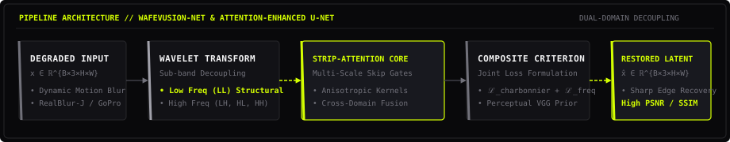

<div align="center">
  
</div>

<br/>

<div align="center">

[](https://github.com/PRAANN07)
[](https://www.linkedin.com/in/som-praneeth-babu-mamidala-788441216/)
[](mailto:mspb23012007@gmail.com)
[](https://github.com/PRAANN07)

</div>

<br/>

```
========================================================================================
[SYS.INDEX]     :: MAMIDALA SOM PRANEETH BABU // @PRAANN07
[DEGREE]        :: B.TECH CSE (ARTIFICIAL INTELLIGENCE) • AMRITA VISHWA VIDYAPEETHAM
[DOMAIN]        :: COMPUTER VISION • ATTENTION MECHANISMS • DUAL-DOMAIN FUSION • ENSEMBLES
[PUBLICATIONS]  :: IEEE NIGERCON '26 • ICRAIC2IT-2025
[STATUS]        :: ACTIVE EXPERIMENTATION & DEEP VISION RESTORATION
========================================================================================
```

---

### 01 // ARCHITECTURAL DOSSIER & RESEARCH PIPELINE

My research explores **computational vision, frequency-spatial latent decoupling, and high-fidelity image restoration**. Rather than relying on standard convolutional baselines, I engineer architectures that decouple high-frequency spatial transients from structural low-frequency representations using wavelet decompositions, directional strip-attention, and composite perceptual-frequency loss formulations.

<br/>

<div align="center">
  
</div>

<br/>

---

### 02 // FLAGSHIP RESEARCH & REPOSITORIES

| TENSOR SYSTEM | CORE ARCHITECTURE & DISCIPLINE | BENCHMARKS & OBJECTIVES | DISPATCH / CODE |
| :--- | :--- | :--- | :--- |
| **WaveFusion-Net** <br/>`IEEE NIGERCON 2026` | **Dual-Domain Wavelet Decoupling**<br/>• Frequency-domain spatial fusion<br/>• StripAttention anisotropic kernels<br/>• Leakage-free 12-split mathematical proofs | **RealBlur-J & GoPro**<br/>• Rigorous ablation suite<br/>• Dynamic motion deblurring<br/>• Reproducible execution traces | [inspect archive](https://github.com/PRAANN07) |
| **Multi-Scale Attention U-Net** <br/>`ICRAIC2IT-2025` | **Cross-Scale Skip Attention Gates**<br/>• CBAM & multi-receptive field spatial attention<br/>• Joint $\mathcal{L}_{\text{Charbonnier}} + \mathcal{L}_{\text{Freq}}$ criterion | **GoPro Benchmark**<br/>• **28.1 dB PSNR / 0.815 SSIM**<br/>• Perceptual edge recovery | [view repo](https://github.com/praann07/Multi-Scale-Attention-Enhanced-U-Net-for-Image-Deblurring-with-Composite-Loss-Functions) |
| **Photovoltaic Fault Detection** | **Heterogeneous Stacking Ensemble**<br/>• Multi-stage meta-learning classifier<br/>• AdaBoost + RandomForest + GradientBoosting | **250-kW Solar Array**<br/>• **93% Classification Accuracy**<br/>• Real-world sensory degradation modeling | [view repo](https://github.com/praann07/Photovoltaic-Array-Fault-Detection-Using-a-Stacking-Classifier-Ensemble) |
| **Mechanistic Causal Tracing** | **Residual Stream Steering (RRAP)**<br/>• Activation patching & causal intervention<br/>• Open-weight LLMs (Llama-3.2-3B, Gemma-2-2B) | **Knowledge Localization**<br/>• TransformerLens probing<br/>• Cross-lingual factual editing | [research logs](https://github.com/PRAANN07) |

---

### 03 // COMPUTE MATRIX & TOOLCHAIN

```
+---------------------------------------------------------------------------------------+
| COMPUTE LAYER        | TECHNOLOGIES & TOOLSETS                                        |
+---------------------------------------------------------------------------------------+
| Deep Learning Core   | PyTorch • Torchvision • PyTorch Lightning • TensorFlow • Keras |
| Computer Vision      | OpenCV • Albumentations • PyWavelets (DWT) • Scikit-Image      |
| Ensemble & ML        | Scikit-Learn • XGBoost • LightGBM • CatBoost • Pandas • NumPy  |
| Hardware & System    | NVIDIA CUDA • Linux (Ubuntu/Debian) • Git • Docker • Bash     |
| Experiment Tracking  | JupyterLab • Weights & Biases • Kaggle GPU Clusters           |
+---------------------------------------------------------------------------------------+
```

<br/>

<div align="center">
  
</div>

<br/>

---

### 04 // REAL-TIME TELEMETRY & REPOSITORY ACTIVITY

<div align="center">
  <a href="https://github.com/PRAANN07">
    
  </a>
  &nbsp;&nbsp;
  <a href="https://github.com/PRAANN07">
    
  </a>
</div>

<br/>

---

### 05 // TERMINAL DISPATCH & COLLABORATION

```bash
$ curl -s https://praann07.network/connect.json
{
  "author": "Mamidala Som Praneeth Babu",
  "handle": "PRAANN07",
  "affiliation": "Amrita Vishwa Vidyapeetham, Coimbatore",
  "research_interest": ["Computer Vision", "Restoration", "Attention Dynamics", "Interpretability"],
  "coordinates": {
    "personal_email": "mspb23012007@gmail.com",
    "student_email": "cb.sc.u4aie24029@cb.students.amrita.edu",
    "linkedin": "https://www.linkedin.com/in/som-praneeth-babu-mamidala-788441216/",
    "github": "https://github.com/PRAANN07"
  },
  "status": "Open to Research Collaboration, Internships & Engineering Innovations"
}
```

<br/>

<div align="center">
  <sub>Constructed with mathematical precision & brutalist design discipline • Mamidala Som Praneeth Babu © 2026</sub>
</div>
