  

    

  <!-- Dynamic Typing Subtitle -->
  

   

  <!-- Featured Production App Quick-Links -->
  

    
    &nbsp;
    
    &nbsp;
    
    &nbsp;
    
  

---

### Activity

  

 

  
  &nbsp;
  
  &nbsp;
  

 

  <table border="0">
    <tr>
      <td>
        
      </td>
      <td>
        
      </td>
    </tr>
  </table>

   

  

---

### About

I'm a third-year B.Tech student in Computer Science and Engineering (Artificial Intelligence) at Amrita Vishwa Vidyapeetham, Coimbatore (CGPA: 7.64).

I created [Coast](https://play.google.com/store/apps/details?id=in.coastapp.app&hl=en), a peer-to-peer ride-sharing app live on the Google Play Store. The rest of my work spans deep learning research and full-stack systems engineering:

- Built and shipped Coast end-to-end using Expo, React Native, and Supabase.
- Working on frequency-spatial decoupling architectures, wavelet transforms, and attention mechanisms for blind motion deblurring (accepted at IEEE NIGERCON '26).
- Investigating cross-lingual causal tracing and factual editing in open-weight LLMs (Llama-3.2, Gemma-2) through representation and activation patching.
- Building voice-controlled autonomous quadcopters on ESP32 microcontrollers and simulating flight dynamics in MuJoCo.
- Building kernel simulators for process scheduling, deadlock handling, and hardware fault injection in C and Python.

---

### Coast

  <table width="100%">
    <tr>
      <td width="65%" valign="top">
        <h3><a href="https://play.google.com/store/apps/details?id=in.coastapp.app&hl=en">Coast: Peer-to-Peer Ride Sharing</a></h3>
        
<strong>"You're not the only one heading that way."</strong> Coast connects commuters heading the same way so they can share rides and split the cost.

        
Engineering details:

        <ul>
          <li>Built with React Native and Expo for the Android client.</li>
          <li>Backend on Supabase and PostgreSQL, matching riders by spatial distance in real time.</li>
          <li>User coordinates are nudged 60–180m before being stored, so exact home/work locations are never saved.</li>
          <li>Phone numbers are only shared once both sides confirm a ride.</li>
          <li>Peer-to-peer settlement, no in-app cut or platform fee.</li>
        </ul>
        

          
          &nbsp;
          
          &nbsp;
          
        

      </td>
      <td width="35%" align="center" valign="middle">
        
      </td>
    </tr>
  </table>

---

### Computer Vision, Deep Learning & Medical AI

| Project | Key Architecture & Highlights | Tech Stack | Benchmark / Result |
| :--- | :--- | :--- | :--- |
| [**WaveFusion-Net**](https://github.com/praann07/wavefusion-net-nigercon2026) | **Dual-Branch Spatial-Wavelet Fusion for Image Deblurring** Decouples high-frequency spatial transients from structural content using discrete wavelet transforms and StripAttention anisotropic kernels. Benchmarked on RealBlur-J and GoPro, with 12 verified leakage-free split checks. | PyTorch, PyWavelets, Torchvision, Albumentations | **IEEE NIGERCON 2026** |
| [**Multi-Scale Attention U-Net**](https://github.com/praann07/Multi-Scale-Attention-Enhanced-U-Net-for-Image-Deblurring-with-Composite-Loss-Functions) | **Image Deblurring with Composite Loss Functions** U-Net architecture with CBAM spatial/channel attention gates and a joint Charbonnier + FFT frequency-domain loss. | PyTorch, OpenCV, JupyterLab, CUDA | **28.1 dB PSNR / 0.815 SSIM** (GoPro) |
| [**Knee OA KL-Grading**](https://github.com/praann07/knee-oa-kl-grading-resnet-scratch) | **Osteoarthritis Severity Classification from X-rays** Trained a ResNet ensemble from scratch (zero pretrained weights) for Kellgren-Lawrence grading (G0–G4). Includes Grad-CAM visual explainability. | PyTorch, ResNet, Grad-CAM, Scikit-Learn | **65.7% Acc • Cohen's κ 0.813** |
| [**Online Exam Behavior Proctor**](https://github.com/praann07/Online-Exam-Behavior---Suspicious-Activity-Detection) | **Suspicious Activity Detection in Online Proctoring** Real-time computer vision pipeline tracking head pose estimation, gaze direction deviation, and multi-person anomaly detection during online assessments. | OpenCV, MediaPipe, Dlib, Python | Real-Time CV Proctoring |

---

### LLMs, Mechanistic Interpretability & AI Systems

| Project | Key Architecture & Highlights | Tech Stack | Focus / Result |
| :--- | :--- | :--- | :--- |
| [**The Babel Effect**](https://github.com/praann07/babel-effect) | **Cross-Lingual Causal Tracing & Rank-1 Editing in LLMs** Investigates knowledge localization and factual editing in Llama-3.2-3B-Instruct across English, Spanish, and Hindi. Includes pre-registered hypotheses and verifiable claim manifests. | PyTorch, TransformerLens, Hugging Face, LaTeX | Causal Tracing (EN/ES/HI) |
| [**Juriscope & JuriRAG**](https://github.com/praann07/Juriscope) | **Legal Intelligence & Statutory Retrieval System** Hybrid semantic search and Retrieval-Augmented Generation (RAG) platform for statutory interpretation, case law analysis, and legal document reasoning. | Python, LangChain, ChromaDB, FastAPI | Statutory Legal RAG |
| [**HospiCall-AI**](https://github.com/praann07/HospiCall-AI) | **Automated Telephony Healthcare Intake Assistant** Conversational clinical assistant automating patient intake, triage symptom assessment, and hospital department routing via voice interfaces. | Python, SpeechRecognition, LLMs, Twilio API | Automated Voice Triage |

---

### Robotics, Autonomous Drones & Simulation

| Project | Key Architecture & Highlights | Tech Stack | Focus / Platform |
| :--- | :--- | :--- | :--- |
| [**ESP32 Voice Drone**](https://github.com/praann07/Drones_S5_AB8_ESP32VoiceDrone) | **Voice-Commanded Autonomous Quadcopter** Embedded hardware and firmware architecture using ESP32 microcontrollers, IMU sensor fusion (MPU6050), PID flight stabilization, and offline voice command processing. | C++, ESP-IDF, Arduino, FreeRTOS | Hardware & PID Flight Control |
| [**Drone MuJoCo Simulation**](https://github.com/praann07/drone_mujocoo) | **Physics-Based Drone Dynamics & Control** Simulation environment in MuJoCo testing quadcopter flight dynamics, non-linear aerodynamics, and attitude control algorithms. | Python, MuJoCo, NumPy, SciPy | MuJoCo Physics Sim |
| [**Self-Balancing Robot Simulator**](https://github.com/praann07/Self-Balancing-Robot-Python-Simulator) | **Inverted Pendulum Dynamical Control** Physics simulator implementing PID and state-space LQR controllers for a two-wheeled self-balancing robot with interactive visualization. | Python, C++, Matplotlib, Pygame | PID & State-Space LQR |
| [**Smart City IoT Infrastructure**](https://github.com/praann07/smart-city-iot) | **Urban Telemetry & Distributed Sensor Telematics** IoT edge sensor simulation for smart city monitoring, air quality indices, traffic tracking, and predictive maintenance. | Python, MQTT, Flask, InfluxDB | Distributed MQTT Telemetry |

---

### Applied Machine Learning & Scientific Optimization

| Project | Key Architecture & Highlights | Tech Stack | Performance / Metric |
| :--- | :--- | :--- | :--- |
| [**PV Array Fault Detection**](https://github.com/praann07/Photovoltaic-Array-Fault-Detection-Using-a-Stacking-Classifier-Ensemble) | **Stacking Classifier Ensemble for Solar Arrays** Multi-model ensemble (AdaBoost, Random Forest, Gradient Boosting) detecting electrical line-line and open-circuit faults in a 250-kW PV system. | Scikit-Learn, Pandas, NumPy, Seaborn | **93% Classification Accuracy** |
| [**Genomic Cancer Prediction**](https://github.com/praann07/genomic-cancer-prediction) | **Bioinformatics Cancer Stage Classification** Machine learning pipeline classifying clinical tumor progression stages from high-dimensional genomic gene expression datasets. | Python, BioPython, Scikit-Learn, PCA | Tumor Stage Classification |
| [**ADMM Diet Optimization Engine**](https://github.com/praann07/NutriSurvey----ADMM-Diet-Optimization-Engine) | **Convex Optimization for Nutritional Planning** Implementation of the Alternating Direction Method of Multipliers (ADMM) algorithm to solve constrained convex optimization problems for large-scale dietary planning. | Python, NumPy, Convex Optimization | Constrained Convex Optimization |
| [**Flight Delay Bayesian Network**](https://github.com/praann07/flight-delay-bayesian-network) | **Probabilistic Causal Disruption Modeling** Bayesian network architecture modeling causal interdependencies between meteorological variables, aircraft turnarounds, and systemic airport delays. | Python, pgmpy, Pandas, NetworkX | Probabilistic Causal Modeling |

---

### Full-Stack, Mobile Apps & Operating Systems

| Project | Key Architecture & Highlights | Tech Stack | Deployment / Performance |
| :--- | :--- | :--- | :--- |
| [**Coast Mobile App**](https://github.com/praann07/coast-app) | **Peer-to-Peer Transit Mobile Platform (Production)** Full-stack ride-sharing application with real-time geospatial driver matching, 60–180m privacy location fuzzing, and direct settlement. | React Native, Expo, Supabase, PostgreSQL | [Google Play](https://play.google.com/store/apps/details?id=in.coastapp.app&hl=en) • [Website](https://coastapp.in/) |
| [**FitStack Gym Progression**](https://github.com/praann07/FitStack) | **Fitness & Workout Progression Tracker** Training tracking app with exercise telemetry, 1RM calculations, progressive overload analytics, and cloud synchronization. | TypeScript, React Native, Node.js | 1RM Progressive Overload |
| [**OS Fault & Recovery Simulator**](https://github.com/praann07/os-fault-simulator) | **Kernel Fault Injection & Deadlock Simulator** Operating system simulator featuring process scheduling, deadlock detection (Banker's Algorithm), and hardware fault injection with a C engine and Flask dashboard. | C, Python, Flask, HTML5 | Banker's Algorithm & Fault Injection |
| [**Job Scheduling Simulator**](https://github.com/praann07/-Job-Scheduling-Simulator-in-OS) | **CPU Scheduling Algorithms Visualizer** Simulates operating system process scheduling (FCFS, SJF, Round Robin, Priority), cutting mean wait times by 15% through optimized priority queues. | Java, Python, JupyterLab | 15% Mean Wait Time Reduction |
| [**DropTail vs RED Queue Analysis**](https://github.com/praann07/computer-Networks-Project---DropTail-vs-RED-Queue-Management-Analysis) | **Network Congestion Control Evaluation** Comparative networking study using NS-2 simulations, AWK telemetry scripts, Packet Tracer demos, and Wireshark validation to evaluate buffer queue performance. | NS2, Tcl, AWK, Python, Wireshark | NS-2 Queue Congestion Analysis |

---

### Skills & Tools

  <table border="0">
    <tr>
      <td align="right"><strong>Languages</strong></td>
      <td>
        
      </td>
    </tr>
    <tr>
      <td align="right"><strong>AI / Deep Learning</strong></td>
      <td>
        
      </td>
    </tr>
    <tr>
      <td align="right"><strong>Mobile &amp; Web</strong></td>
      <td>
        
      </td>
    </tr>
    <tr>
      <td align="right"><strong>Databases &amp; Cloud</strong></td>
      <td>
        
      </td>
    </tr>
    <tr>
      <td align="right"><strong>Developer Tools</strong></td>
      <td>
        
      </td>
    </tr>
  </table>

---

### Get In Touch

  
Open to research collaborations, internships, and interesting AI/software projects.

  
  

    
    &nbsp;&nbsp;
    
    &nbsp;&nbsp;
    
  

  © 2026 Mamidala Som Praneeth Babu

